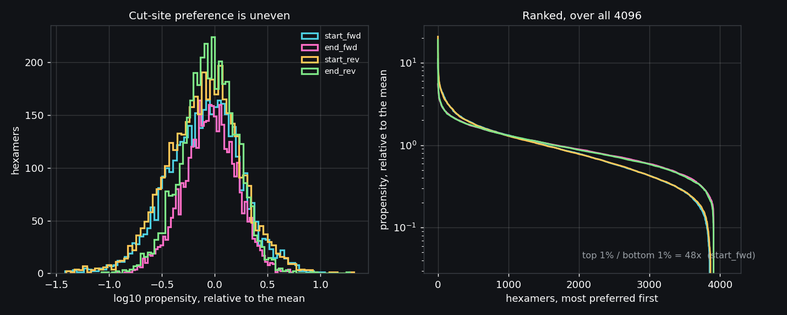
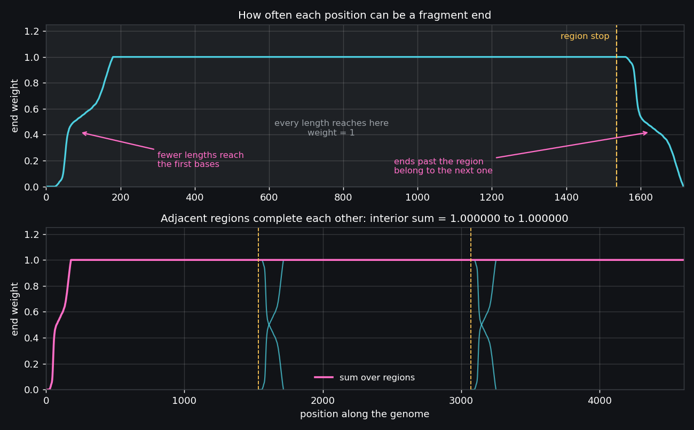

# The cut-site fragment simulator

This simulator produces cfDNA fragments whose true generating probability is
known. Real data never offers that. With it, a model can be asked two questions
it cannot otherwise be asked: does it recover the parameters that made the data,
and how close is it to the best score any model could reach?

## 1. What the model captures

A fragment is a cut at each end of a double-stranded molecule. The simulator
models where those cuts fall and how far apart they are.

- **Cut-site sequence preference.** Some 6-base sequences are cut far more often
  than others. That preference is measured on a real sample, so simulated
  fragments carry the same sequence signature at their ends.
- **Fragment length**, drawn from the distribution measured on the same sample.
- **Strand**, a fair coin.
- **Depth.** Each region gets as many fragments as the real sample had there.

**Not captured:** bulk GC (the length profile matches, the length–GC joint does
not); anything in a fragment's interior; and lengths outside 25–180 bases, which
are filtered out of the real data before measurement.

## 2. How a fragment is drawn

Within one region:

1. **Strand** — flip a fair coin.
2. **Start** — choose a start position, with probability proportional to the
   propensity of the 6-mer there.
3. **Length** — choose a length, with probability proportional to the propensity
   of the 6-mer at the resulting far end, times the measured length
   distribution.
4. **Repeats** — if this start and length were already drawn in this region,
   draw both again.

The probability of the resulting fragment is recorded.

## 3. Propensity

Every step above reads one quantity, the propensity of each of the 4096 6-mers:

    r(h) = C(h) / N(h)

`C(h)` counts how often `h` was a cut site in the real sample. `N(h)` counts how
often it would have been if cutting ignored sequence. Their ratio is how much
that sequence is preferred.

Preference is strongly uneven and roughly lognormal: across 5,000 regions of
RD-56804 the most-preferred 1% of hexamers are cut about 48 times as often as
the least-preferred 1%. That spread is what the simulator reproduces and what a
model has to learn. A larger study of these distributions across 92 samples is
in `docs/pending/cut_site_hexamer_counts.md`; it used a different admission
rule, so its counts are not directly comparable with these.

### The four tables

A cut can be at a molecule's 5′ or 3′ end, on either strand, so `C`, `N` and `r`
are each four tables. The strand drawn in step 1 selects which two are read,
because a minus-strand fragment's genomic start is its 3′ end:

| strand | at genomic start `i` | at genomic stop `i + L` |
|---|---|---|
| plus | `r_start_fwd(hex_fwd(i))` | `r_end_fwd(hex_fwd(i + L))` |
| minus | `r_end_rev(hex_rc(i))` | `r_start_rev(hex_rc(i + L))` |

Table names are molecule-relative; denominators are position-relative. So the
`_rev` tables are crossed with respect to their names, and are correct that way:

| table | tallies | divides by |
|---|---|---|
| `start_fwd` | genomic starts | `N_start` |
| `end_fwd` | genomic stops | `N_end` |
| `start_rev` | genomic **stops** | `N_end[perm]` |
| `end_rev` | genomic **starts** | `N_start[perm]` |

Reversing this pairing produced a median 1.2% and maximum 16% error per
propensity cell, silently, with every total intact.

### The two expectations

`N_start` weights every position in the region equally, since under a
sequence-indifferent model any position is an equally likely start.

`N_end` is length-weighted, because a position is reachable as an end only from
starts that lie inside the region. For a region of length `region_len` and the
length distribution's CDF `F`:

    w(i) = F(min(i, max_fl)) − F(max(min_fl − 1, i − region_len))

The ramps are correct rather than a loss. A route excluded at one region's edge
is counted in the neighbouring region, and `C` is tabulated under the same
partition, so adjacent regions sum to exactly 1 in the interior (above,
measured). An **isolated** region, with no neighbour, is genuinely depleted near
its edges — which matters to anyone choosing a crop width or computing an
oracle.

## 4. The steps in detail

Write `s` for the drawn strand, `i` for a position in the region, `l` for a
length, and `valid(·)` for whether the 6-mer at a position is free of non-ACGT
bases.

### 4.1 Strand

Bernoulli with `p_plus = 0.5`, where plus means the fragment's 5′ end is the end
that aligns to the forward reference strand.

The coin is a construction, not a fit. A fragment is double-stranded and has no
intrinsic orientation; the strand label records only which of its two ends became
read 1, and adapter ligation is symmetric. There is nothing to measure.

The strand is drawn first because it decides which pair of tables steps 2 and 3
read, per the table above. Both strands share one `valid` array: validity is a
property of the reference, not of the strand.

### 4.2 Start

Positions are weighted by the propensity of the 6-mer at the start, but only
after excluding positions from which no fragment at all could be made:

    W_s[i, l] = r_end(hex(i + l)) · valid(i + l) · f(l)
    t_s[i]    = Σ_l W_s[i, l]
    live[i]   = t_s[i] > 0
    a_s[i]    = r_start(hex(i)) · valid(i) · live[i]

    P(i | s)  = a_s[i] / Σ_j a_s[j]

`W_s` is the full weight block: for each start, the weight of every length. Its
row sum `t_s[i]` is the total weight available at that start, so `live` marks
the starts from which some fragment can be made. Normalisation is **within the
strand**.

A start belongs to the region containing it, and the region is the half-open
interval `[region start, region stop)`. A fragment starting at the region stop
belongs to the next region. This is what makes every fragment belong to exactly
one region.

### 4.3 Length

Given the start, the length is read off the row already computed:

    P(L | i, s) = W_s[i, L − min_fl] / t_s[i]

so the start and the length come from one weight block rather than two separate
rules.

A length carries zero weight for any of three reasons, and the draw does not
distinguish them — it tests only whether `t_s[i] > 0`:

| factor | zero when | a property of |
|---|---|---|
| `valid` | the far-end 6-mer contains a non-ACGT base | the reference |
| `r_end` | that 6-mer was never observed as a cut site | the sample, and its depth |
| `f(l)` | that length was never observed | the sample |

Two of the three are sample properties, so the same region normalises over
different length sets for different samples.

The support is the measured distribution's own, `[min_fl, max_fl]`, which lies
inside 25–180 because the real fragments were filtered to that range before
anything was measured. The bound is applied once, at that filter; the sampler
does not re-check it.

### 4.4 Repeats

The `(start, stop)` pair is checked against the pairs already drawn in this
region. Strand is not part of the key. On a collision both the start and the
length are drawn again from the same distribution.

Requesting more fragments than a region has positions raises, as does exceeding
twice the requested count in draw attempts. Both raise rather than silently
emitting fewer fragments than asked for.

Because repeats are redrawn, the recorded probability is the first-draw
marginal, which reads slightly high against sampling without replacement.

## 5. What a run produces

| Output | Content |
|---|---|
| BED | one row per simulated fragment, 8 columns |
| `.p.tsv.gz` sidecar | `contig, start, stop, strand, p` — every fragment's generating probability |
| `run.json` | inputs, seed, counts, timings, `oracle_nll` |
| fragment h5 | optional, built from the BED |

The sidecar is what makes the simulation useful. Because repeats are redrawn,
`(contig, start, stop, strand)` is unique, so it joins one-to-one against the
fragments.

**The oracle**, `-mean(log p)`, is the score a model would get if it knew the
generating parameters exactly. No model can beat it. The figure in `run.json` is
pooled over every fragment and the whole length range; a model evaluated on a
subset of regions or a cropped window needs its oracle recomputed over that same
domain, which `scripts/simulator/cut_site_oracle_nll.py` does.

## 6. Running it

    python scripts/simulator/run_cut_site_simulator.py \
      --sample-id SAMPLE \
      --fragments-h5 /efs/analytics/nathanboley/ibd/frag_h5s/SAMPLE.fragments.h5 \
      --region-bed data/region_sets/quiet_v2_pad1200_repeats_removed_tile1536.bed \
      --fasta /efs/analytics/nathanboley/test_fragments_h5/GRCh38.p12.genome.fa.gz \
      --out-dir /efs/analytics/nathanboley/<run> \
      --seed N

A full run covers 66,649 regions in about 7 minutes. The same seed gives the
same output whatever the worker count.

`scripts/simulator/measure_cut_site_hexamers.py` runs the measurement alone and
writes `C`, `N`, `r`, `f(L)` and the per-region counts to an `.npz`.

Region sets live in the main checkout's gitignored `data/region_sets/`:
`..._removed_tile1536` (66,649 regions), `..._removed_tile2560` (11,505),
`..._kept_tile1536` (904,975), `..._kept_tile2560` (523,604).

Runs use GRCh38.p12 at the path above. A store's `config_hash` includes the
reference index, so artifacts built against a different reference will not
compare as equal even where the sequence is identical. Record the reference in
any output.

## 7. Code

| Module | Holds | Depends on |
|---|---|---|
| `background_model/constants.py` | `L_MIN`, `L_MAX`, `N_LENGTHS`, `KMER`, `HEX_HALF`, `NHEX` | `tracks` |
| `background_model/hexamers.py` | 6-mer encoding, RC permutation | numpy, `constants` |
| `background_model/fragment_lengths.py` | `FragmentLengthDist`, `fl_end_weight` | numpy |
| `background_model/simulator/measure.py` | measurement: `C`, `N`, `f(L)`, `r` | pandas, `fragmentomics_tools` |
| `background_model/simulator/draw.py` | the draw, BED and sidecar writer | the above |

`L_MIN = 25` and `L_MAX = 180` derive from the locked `tracks.FL_BANDS`; `L_MAX`
is inclusive. `fragment_lengths.py` sits outside `simulator/` on purpose:
model-side code needs it and must not import the simulator.

Entry points: `measure_sample` (the whole measurement for one sample),
`simulate_fragments_to_bed` (draws every region, writes the output),
`sample_region`, `start_distribution` (the per-region start and length
distributions of §4.2 and §4.3), `oracle_nll`.

Figures in this document are regenerated by
`scripts/simulator/_make_spec_figures.py`, from the real tables and the real
`fl_end_weight`.

## 8. Tests

`tests/test_hexamers.py`, `test_simulator_measure.py`, `test_simulator_draw.py`,
`test_simulator_propensity_denominators.py` and `test_cut_site_hygiene.py`, with
fixtures in `tests/conftest.py` and an independent encoder oracle in
`tests/cut_site_oracle.py` that imports nothing from the repo.
`scripts/_mutation_test.py` carries mutations that must each turn a test red; run
only the entries a change touches.

Run the suite with `make test`, never bare pytest.
